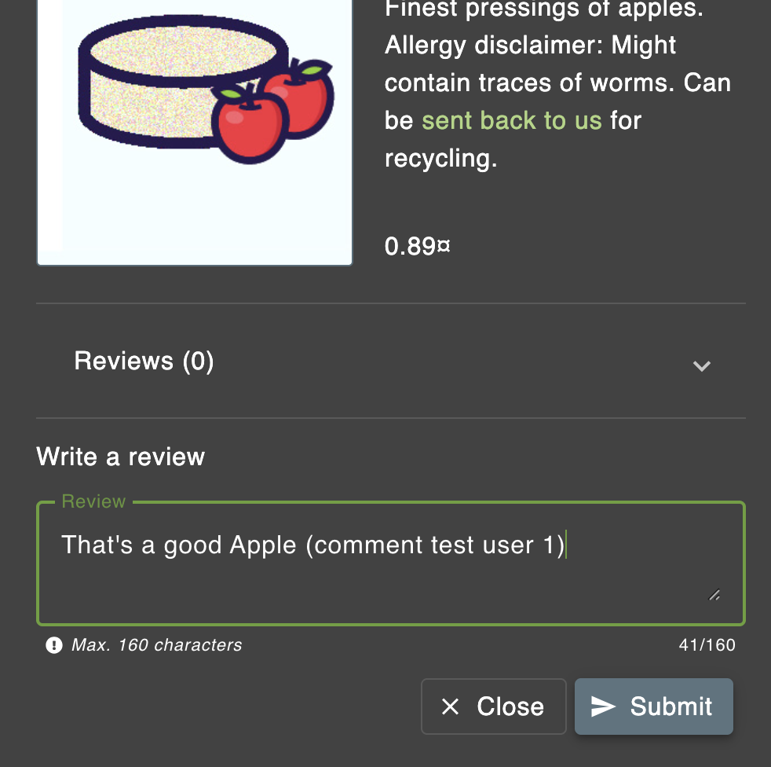
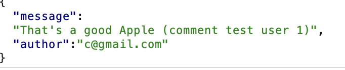
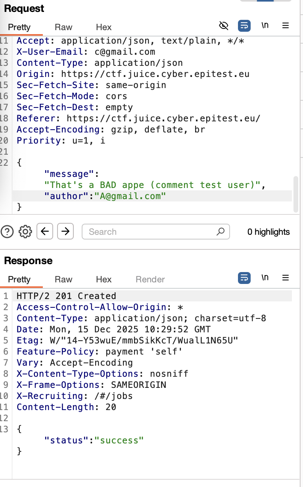
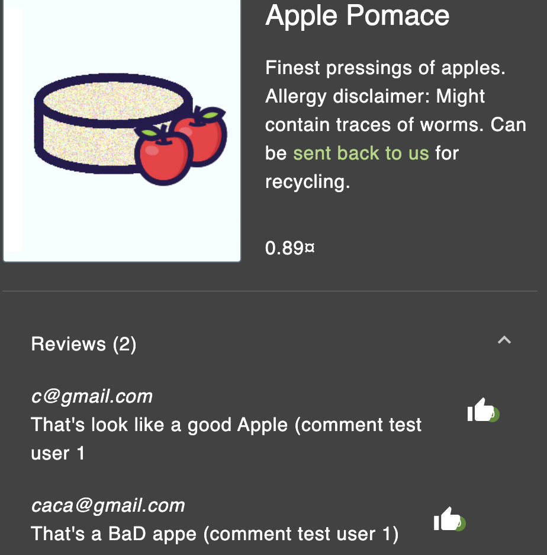

##### **Methodology:**
As i did befor i will try to catch the request when i post a feedback on an exmple 

then finding it :

sending it to the repeater to try to change the message on the json and the mail user :

TO 

then we can see it add a comment from seconde email (caca@gmail.com)

##### **Vulnerability:**

basic Json change
##### **Risks:**
idk
##### **Actions:**
Burb repeater change messsage and author sender .
