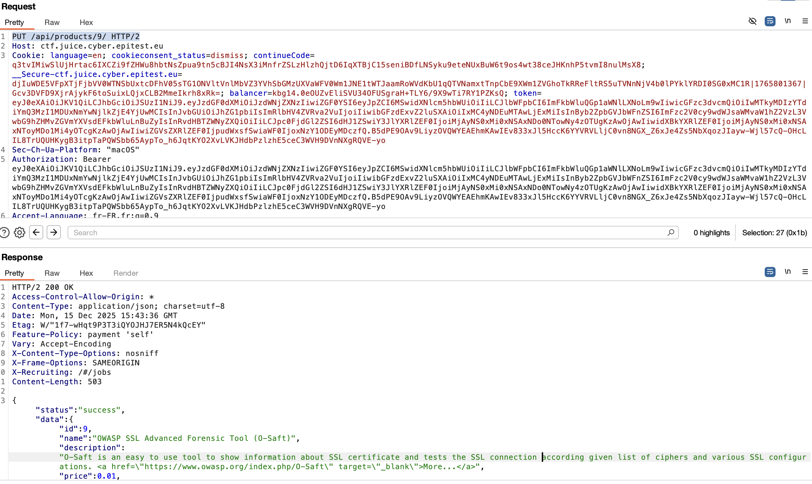
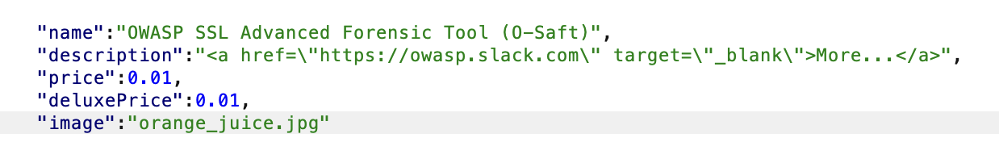
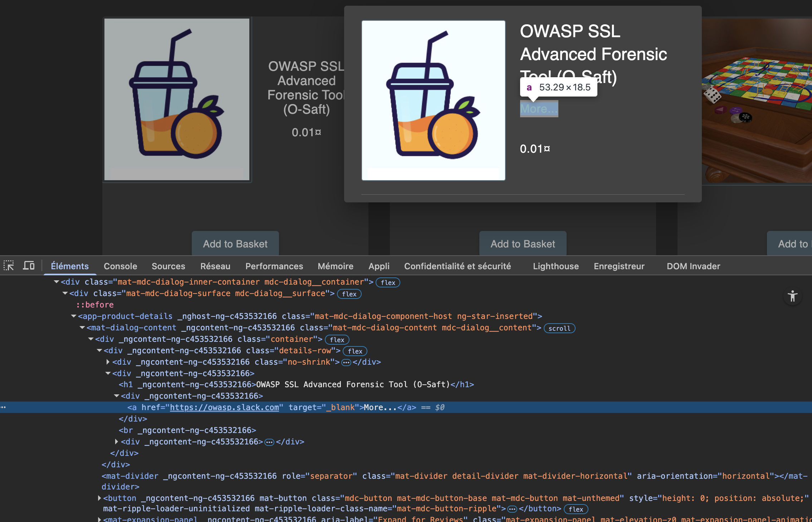

##### **Methodology:**
for this challenge i tried to changes parameters in burp
then i explore all the possibility to change a request , i learn from a website that u can replace "Get" for example by OPTION to know which type of request is available .
I saw that u can easely us PUT request , then i want to parcourir throught l'API so:
 PUT /api/products/9/ HTTP/2
then i send and got a json respons where i can see all the respons:

updating the Json ; with URL-slack (lol):

got the proof of the result here: 

##### **Vulnerability:**

can change any leaks 
##### **Risks:**
bad people can put fishing leaks or malwar directly in the links
##### **Actions:**
