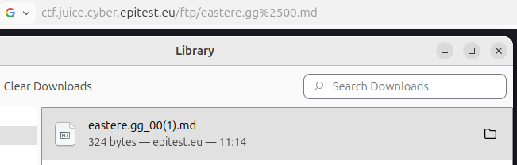

# Easter_Egg

## Methodology

For this challenge i used the PoisonNullByte method that i detailled in another file.
To sum it up i tricked the server into thinking i was downloading a .md file wich is authorized instead of the .gg that is actually the easter egg.

This way i could download it.

## Vulnerability

**Type:** Improper Input Validation
**Component affected:** File handling / FTP download mechanism
**Severity:** Medium

## Risks

   This vulnerability allows an attacker to access internal application routes that should not be exposed to regular users. Once access to the FTP directory is obtained, additional weaknesses such as insufficient file validation can be chained to download sensitive files.

## Actions

All sensitive routes such as FTP directories should be protected by proper access control mechanisms and never be accessible solely by changing the URL.  
In addition, file downloads should be validated server-side using allowlists and strict filename handling, and the application should reject any encoded null bytes or unexpected input during file processing.

