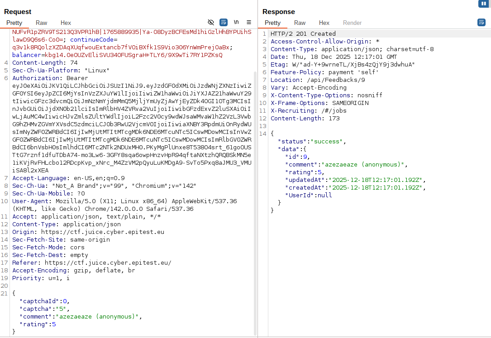

# CAPTCHA_Bypass

## Methodology

For this challenge I started by opening Burp Suite and intercepting the request sent when submitting a customer feedback through the Contact Us form.

The form displays a simple math CAPTCHA, so I first wanted to understand how it was validated server-side. After submitting a feedback once, I inspected the POST request sent to /api/Feedbacks/.

I noticed that the captchaId is always set to 0 and does not change between submissions. This strongly suggests that the CAPTCHA is static and not properly tied to a user session or regenerated for each request.

After confirming this behavior, I sent the request to Burp Repeater and simply resent it multiple time.
Since the server does not revalidate or limit CAPTCHA usage, all requests were accepted.

By resending the same request 10 times rapidly i got the flag.

## Vulnerability

**Type:** Broken Anti-Automation 
**Component affected:** Feedback submission API (/api/Feedbacks/)
**Severity:** Medium

## Risks

    This vulnerability allows an attacker to bypass CAPTCHA protections entirely and automate feedback submissions.
    This could lead to spam, database pollution, or denial of service through mass submissions.

## Actions

CAPTCHA validation should not rely on static identifiers or predictable values. 
Each CAPTCHA must be unique, bound to a user session, and invalidated after a single use.
Additionally, server-side rate limiting should be implemented to prevent rapid repeated submissions, even if CAPTCHA validation fails.
