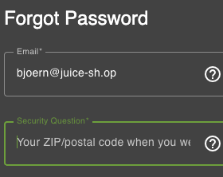
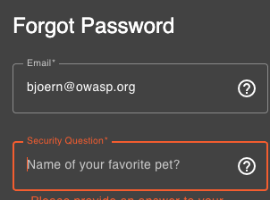
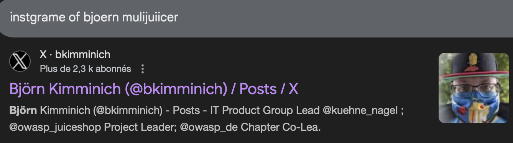
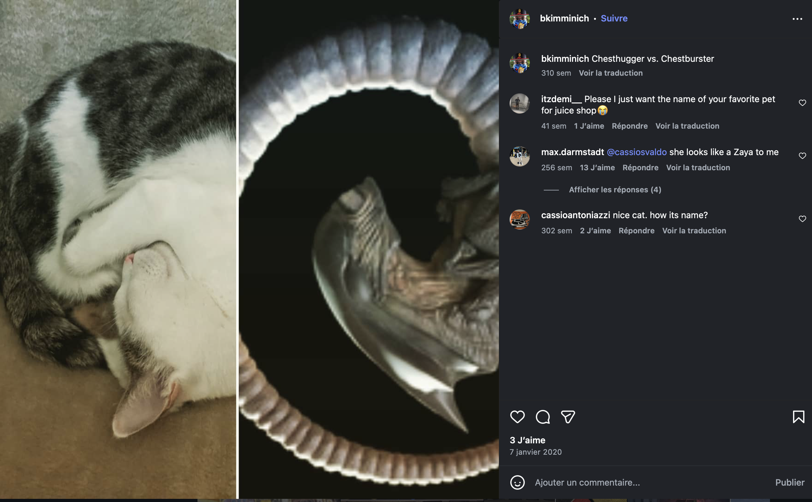

**Reset the password of Bjoern's OWASP account via the Forgot Password mechanism with the original answer to his security question. (Difficulty Level: 3)**

**##### **Methodology:****
My first tought when i read "favorit Pet" was to do some researsh on the guy 'bjoern' , i then find his mail , using a tech that i already use to find all the data on every client{databaseInSql.md}.
So i took a look and find : bjoern@juice-sh.op and bjoern@owasp.org.
try both :

so not that email 

this one better

Now lets do some OSINT , some stalcking
first i putt a basic research on google to find his socials

find his name from his X account but i cant acces it , so i got his name and now i try to find him on instagrame:
Bingo find his public account and scroll a bit to find a pic of his cat .

someone in the comment say 'Zaya' lets try that:

it works 

**##### **Vulnerability:****

**##### **Risks:****

**##### **Actions:****

