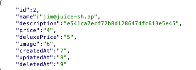
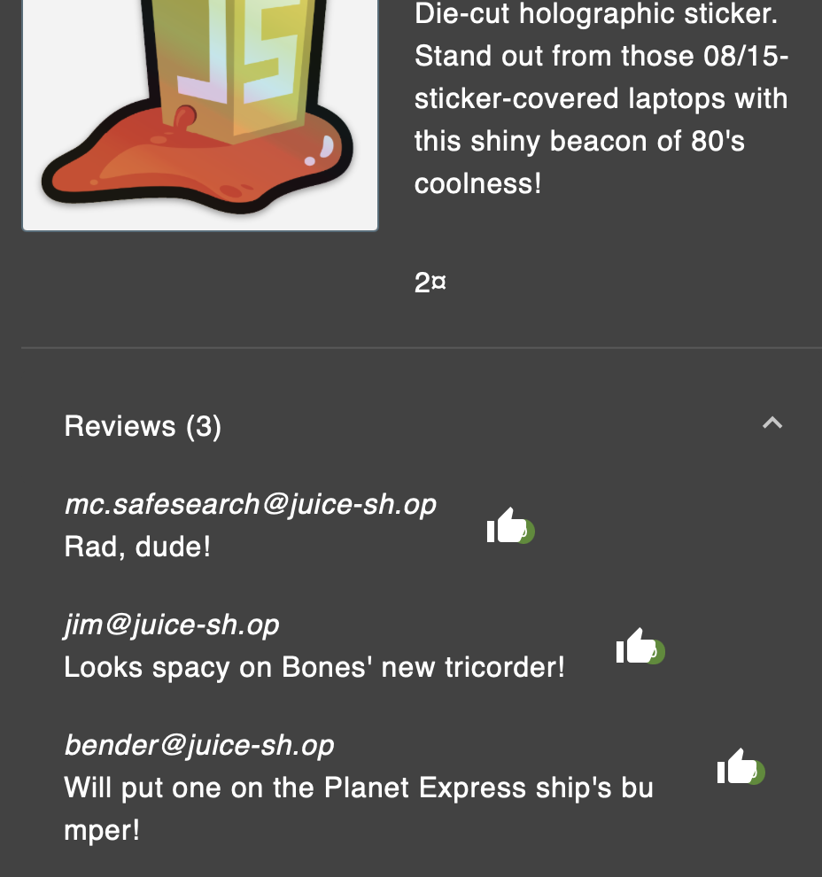
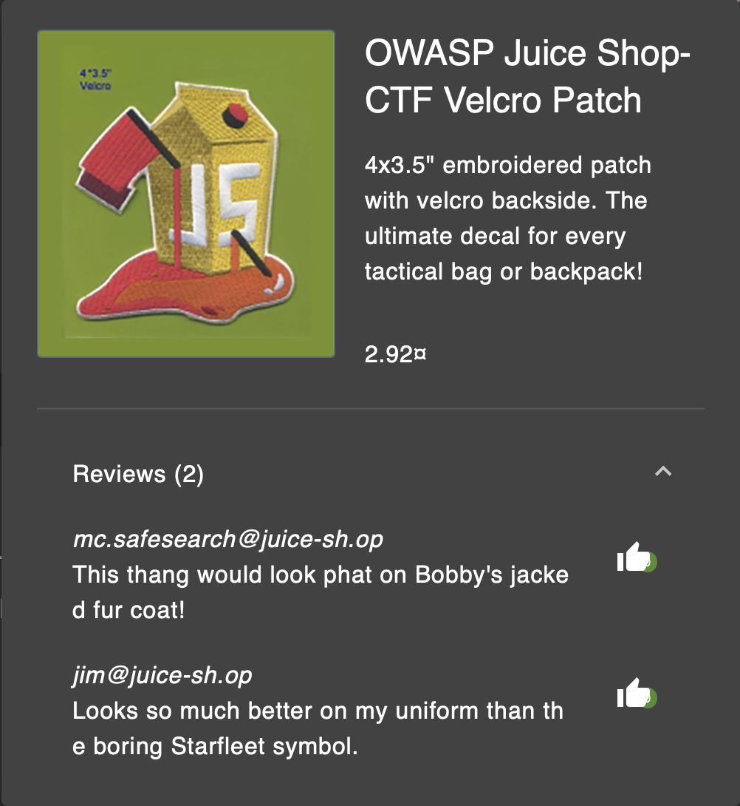
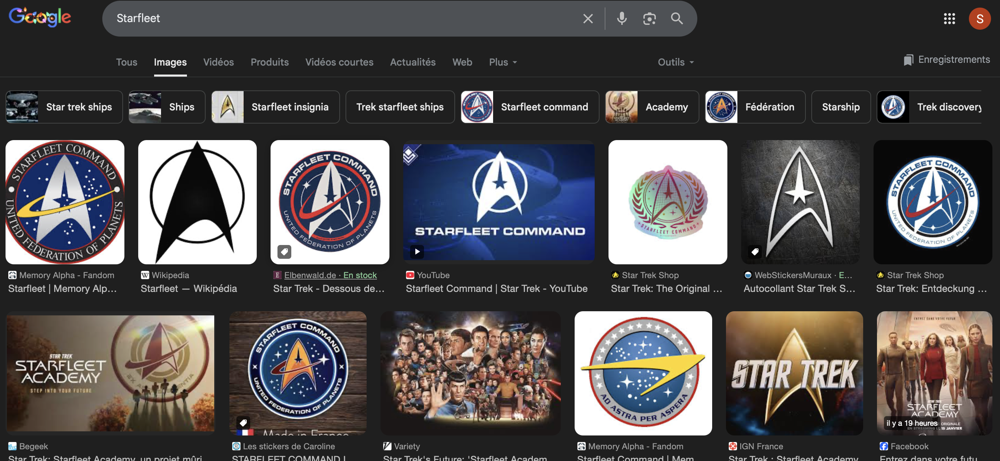
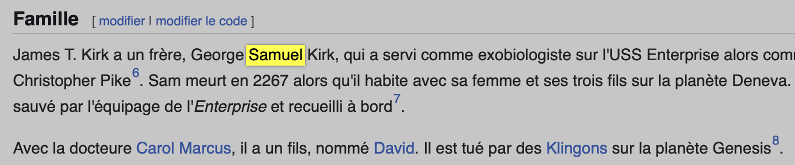
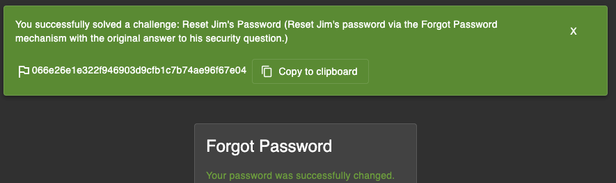

##### Methodology:
So if i understand well its still some OSINT 😅 so yeah… lets stalk again.
First i take a look in `main.js` (ctrl+f `invalid_password` / `user_notfound`) but nothing interesting.

Then i find his mail using the same SQL injection i used before to collect user data:

After that i keep doing research on the products pages to see if he commented something that can answer the security question:

I found some comments where he talk about random stuff:

And then i found this one:

He was talking about stuff like "Starfleet symbol" / "bones tricorder", so i put that on internet and i find its Star Trek references:

I knew nothing about this series, so i ask a friend who know Star Trek. He told me "Jim" can be James T. Kirk. So i check wiki and find the info linked to the security question (redacted):

Then i use the original answer to the security question (redacted) and it works:

---

##### Vulnerability:
**Type:** Weak account recovery (security question guessable by OSINT)  
**Component:** Forgot Password flow (security question)  
**Severity:** High  

---

##### Risks:
- Account takeover only with public infos / references
- Social engineering becomes super easy
- If user reuse same patterns, can impact other accounts too

---

##### Actions:
- Find user email via SQLi
- OSINT on comments + references to deduce security answer (redacted)
- Use Forgot Password flow to confirm reset works
