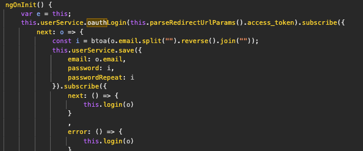
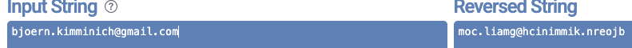
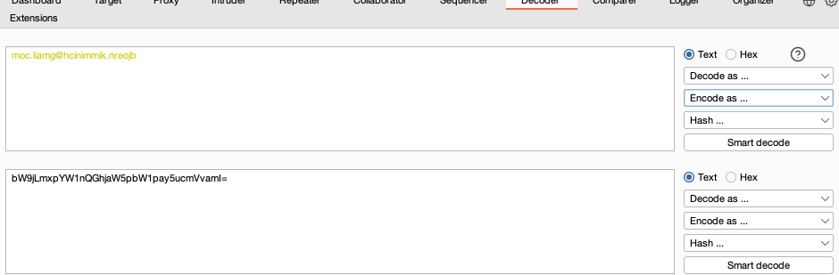
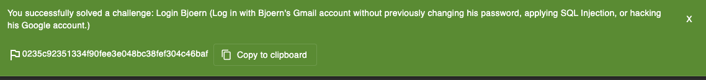

**Methodology:****
I search in `main.js` with different keywords like `authentication`, `login`, `code`, `password`, `authlogin`, etc, and i find an interesting block:

more specifically this line :
const i = btoa(o.email.split("").reverse().join(""));
i look up on the internet to find what it does:
 btoa() is just a base64 encoding function, and it is just encoding a reversed string consisting of the user’s email address

so i reverse the string : 

and decode it with the Burb decoder;

it works 

---

##### Vulnerability:
**Type:** Broken authentication (predictable/reversible login code derived from email)  
**Component:** Frontend auth logic in `main.js` + login endpoint accepting it  
**Severity:** Critical  

---

##### Risks:
- Anyone who knows the target email can login without the real password
- Full impersonation / account takeover
- If this pattern exist on other accounts/endpoints, it’s a big fail

---

##### Actions:
- decode and encode crypted passsword