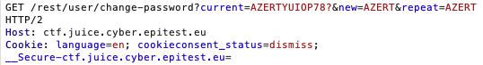
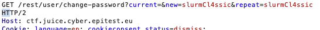
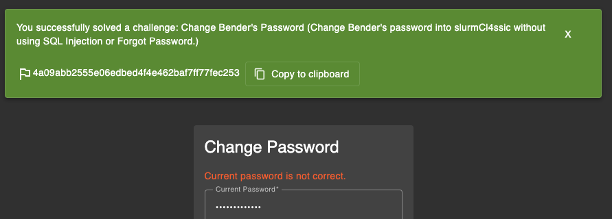

**Change Bender's password into slurmCl4ssic without using SQL Injection or Forgot Password. (Difficulty Level: 5)**
**##### **Methodology:****
I log in on the bender account from my reset pasword from the previous challenge .
then i went to the 'change password' parameters on the wbesite and rty to catch the req when i put a new password (with a fake correcte password)C

then try to understand the line : change-password?current=AZERTYUIOP78?&new=AZERT&repeat=AZERT
the current objectif is to cahnge the password into 'slurmCl4ssic' so i try to replace (i sent to the repeater before)the 'new' and 'repeat'but got few code 401 and the final try that succes :

and got 

**##### **Vulnerability:****

**##### **Risks:****

**##### **Actions:****