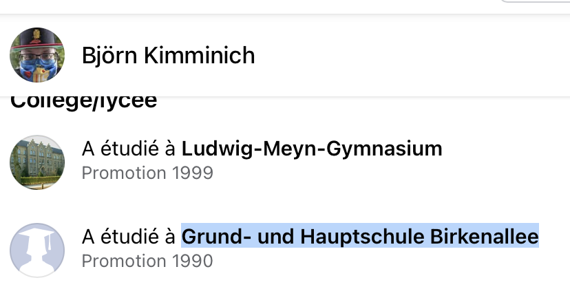
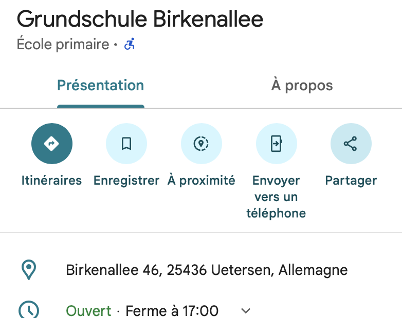
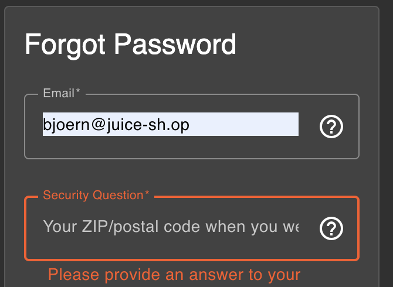
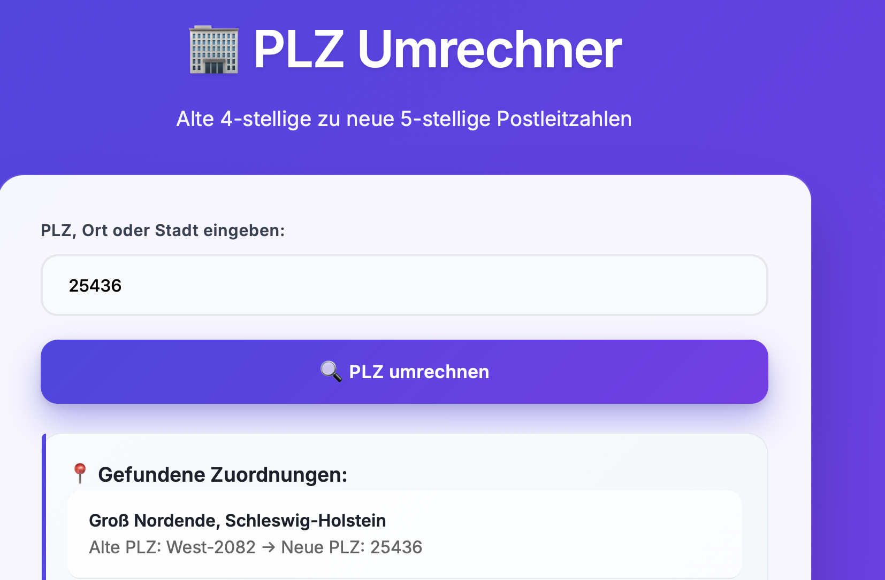
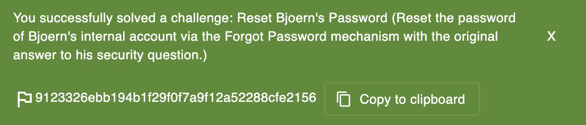

##### Methodology:
Vamos do some OSINT again 
I take his email (`bjoern@juice-sh.op`) and use forgot password. The security question was:
"Your ZIP/postal code when you were a teenager?"

So i stalk his facebook and i find this:

I look it up on the internet to get the postal code:

I try `25436` but its not working:

At first i was stuck because i found nothing else. I even try stuff like encoding (base64 etc) but nope...
Then i realize it was like 35 years ago, so maybe the postal code format changed with time.

So i search a converter / old format, and i find that the old code can be different:

I try `West-2082` and it works lol

---

##### Vulnerability:
**Type:** Weak account recovery (security question guessable by OSINT / historical data)  
**Component:** Forgot Password flow (security question: old postal code)  
**Severity:** High  

---

##### Risks:
- You can reset an account just with public infos + old data
- Easy account takeover without owning email/password
- Security questions are a big weak point if answers are discoverable

---

##### Actions:
- Use forgot password with target email
- OSINT on social media to find location infos
- Look up postal code + try old format conversion
