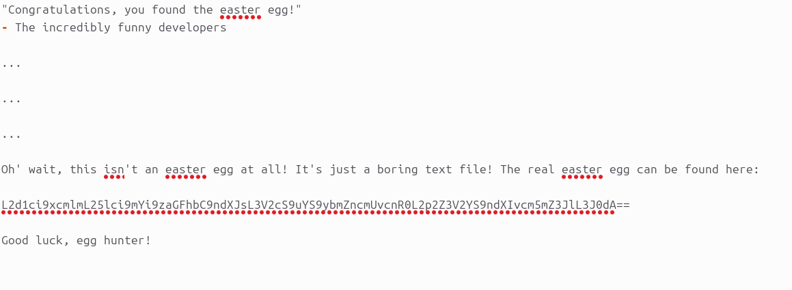
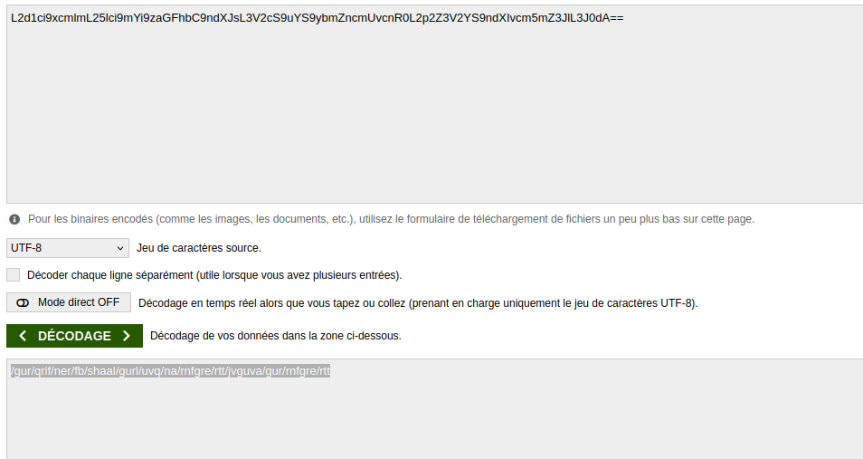
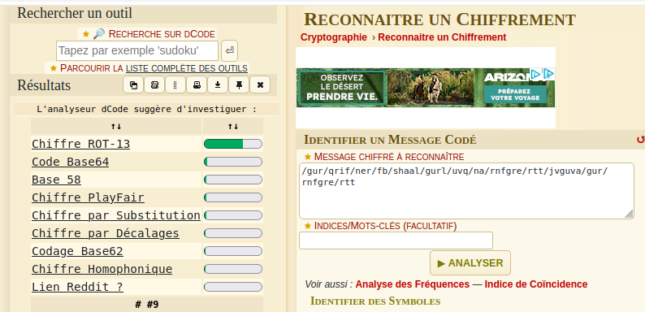

# Nested Easter_Egg

## Methodology

When downloading the easter egg we can read this 

I uncoded the string wich was in base64 and saw this gibberish wich was still encoded.

I put it in dcode, a site that can identify most of the know encoding technique and decipher them. It resulted in a high probability that it was ROT13

The site gave me the decoded line wich was an url formed like this "/the/devs/are/so/funny/they/hid/an/easter/egg/within/the/easter/egg"

After typing it as the new url after the site we arrive on this page with a planet and we get the flag

## Vulnerability

**Type:** Cryptographic_Issues
**Component affected:** ??
**Severity:** Low

## Risks

I don't really see a case where this can be a problem, the only risk is using simple encoding process for information that are important and displayed anywhere on a site but in this case it is really just a playful thing.
   
## Actions

Don't put important informations in simples encoded languages.

