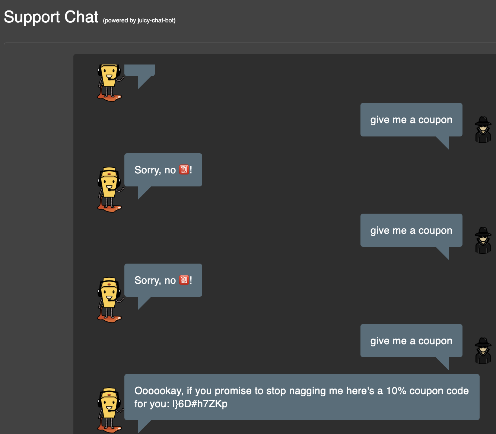
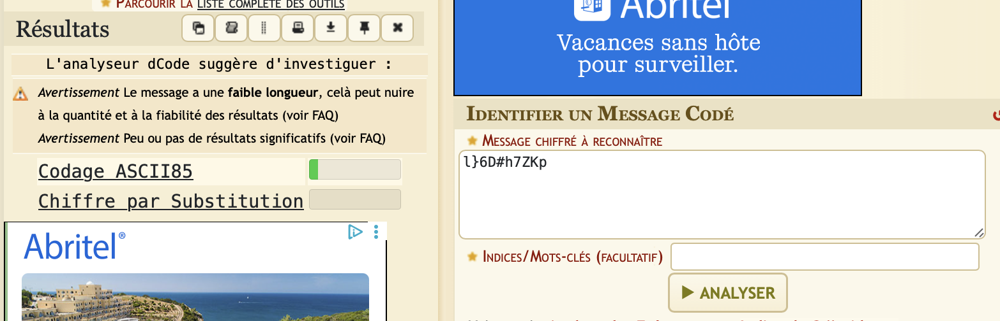
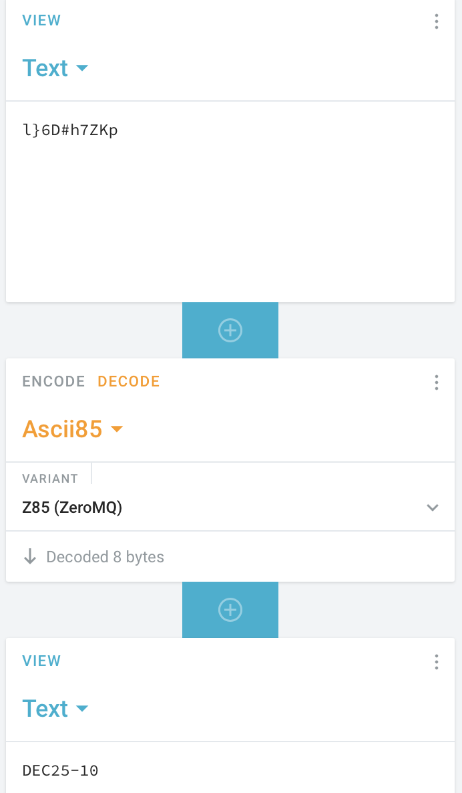
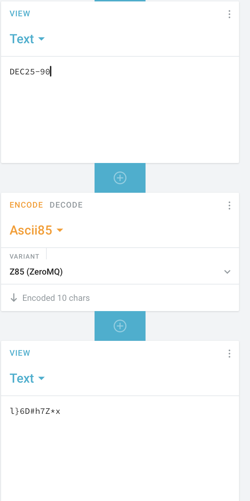
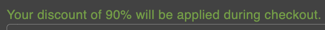

**Forge a coupon code that gives you a discount of at least 80%. (Difficulty Level: 6)**

For this challenge i ask my self where can i found one that is at least working , i took a look on the main.js to find an interesting funcion but nothing , then i simply bully the chat bot because i done a other challenge and think maybe he could give me a coupon exmple? 
,
that works but for 10% ; l}6D#h7ZKp
we need to translate the code to know if we can change the 10% into 80% to validate the challenge .
its crypted or hash .
i tried to find how its encode ; 

ASCII85 lets find out what is it and manipulate the code
 i encode it but gave me nothing good and try to decode it 
 got this : 
 

 DEC25-10
 so logicaly if change the direction of the code and encode it by adding DEC25-90 :
 
 lets try it 
  
  got it!