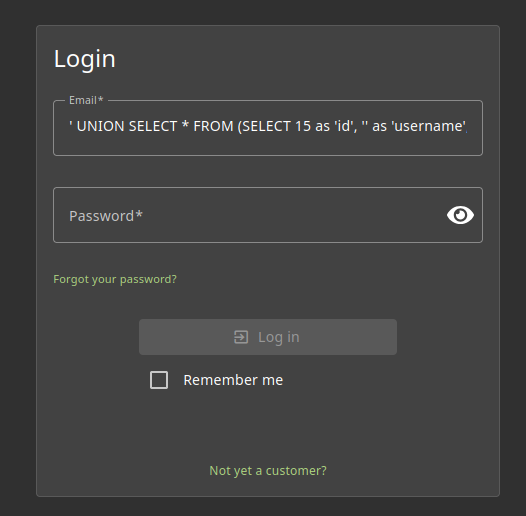

# Ephemeral Accountant 

## Methodology

Using the informartion that i got with the database_schema and user_credentials i figured i would just have to create inside the login form an account for wich i would complete all the row necessary with a union command.
This way i could create any account inside the login form as long as i entered valid values inside the intended rows.

## Vulnerability

**Type:** SQL Injection (synthesizing a login row via UNION)  
**Component:** Login form and database
**Severity:** Critical

## Risks
    An attacker can impersonate users even with admin permissions by returning crafted rows, enabling immediate access to sensitive functionality without database writes. This is a severe authentication bypass vector.
An attacker can also write a delete statement that would create enormous loss of valuable data.

## Actions

Eliminate the possibility of injections by using parameterized statements and ensuring the login verifies credentials properly (e.g., compare hashed passwords).