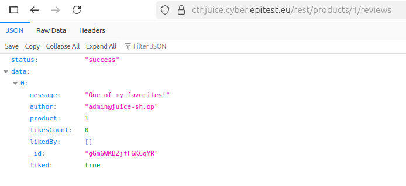
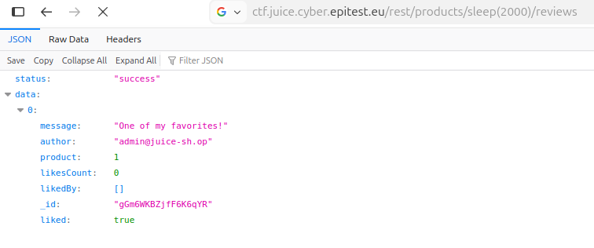

# NoSQL_DOS

## Methodology

For this challenge, I interacted directly with the backend REST API handling product reviews. By observing the available endpoints, I identified that product reviews could be accessed via the following route:

"https://ctf.juice.cyber.epitest.eu/rest/products/{id}/reviews"

A normal request to retrieve the reviews of product ID 1 works as expected:

I then tested whether the backend correctly validated the {id} parameter. By replacing the ID with a function call, I injected a sleep(2000) instruction directly into the URL:

The server response was delayed, confirming that the backend executed the injected command. This successfully solved the challenge.

## Vulnerability

**Type:** SQL Injection
**Component:** Review endpoint and database
**Severity:** Medium

## Risks
    
    This vulnerability allows an attacker to inject unintended function calls through unvalidated route parameters.This could be abused to perform denial of service attacks by forcing the server to sleep repeatedly, degrading performance or making the service unavailable.

## Actions

Route parameters should be strictly validated server-side and restricted to expected data types. The backend should never interpret user-controlled URL segments as executable expressions and must reject any non-numeric or malformed input before processing the request.