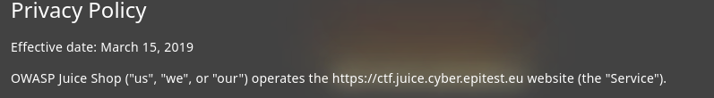

# Privacy-Policy-Inspection

## Methodology

For this exercice i simply read the privacy policy terms of the site and noticed that certain words were glowing so i wrote them up.

All these glowing words got the span class "hot" so i searched up all of them and got this : https://ctf.juice.cyber.epitest.eu We may also instruct you to refuse all reasonably necessary responsibility
I thought i could just add it in one block to the adress but it didn't worked so i tried to put / between all words to form the link

This time i got the flag.

## Vulnerability

**Type:**  Tomfoolery
**Component:** router
**Severity:** Low

## Risks
    An attacker can use routes that aren't supposed to be used, in this case it is voluntary just to find a little page but if routes  aren't securised it can lead to trouble if a user touch say an admin panel.

## Actions

Securise the route with a redirection when the user is not authentified or allowed on the page.