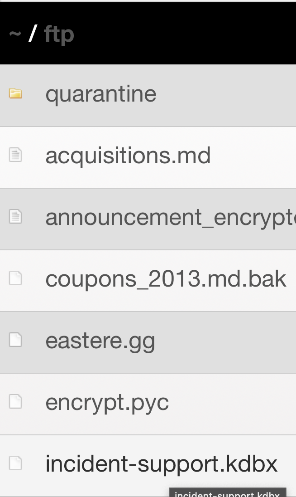
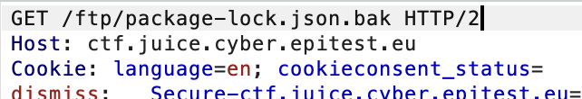
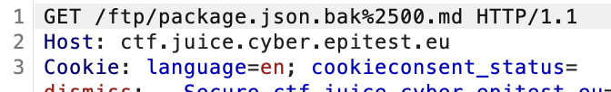

##### **Methodology:**
i started frome the about us page whith th link more that make us discover a ftp path, inculding 'suspicious_error.yml' and 'package.json.bak'.

but we cant acces bc **“Error: Only .md and .pdf files are allowed!”**
to bypass filter i use burp suite
 changin this to

The idea is that %25 is the URL-encoded form of the % character, so %2500 becomes %00 after the first URL decode on the server side.  
The filter sees the filename as package.json.bak%00.md, which ends with .md, so it allows the request.  
The underlying filesystem, however, treats the null byte (%00) as the end of the string and only opens package.json.bak.
##### **Vulnerability:**
##### **Risks:**
##### **Actions:**
poison null byte 
Double encodage
we use %2500

